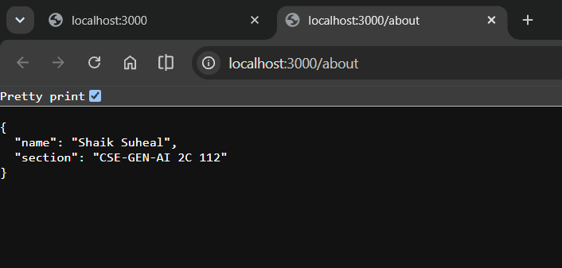

# Lab 1: Node.js and Express server

**Name:** Shaik Suheal · **Registration number:** 252U1R9145 · **Section:** CSE-GEN-AI 2C 112

**Course:** Backend Development Fundamentals · **Lab Number:** 01

## Live Link

**Deployment URL:** https://bdf-lab-01.vercel.app
<!-- Replace with your public URL. If not deployed, write why and add Postman screenshots of every endpoint. -->

## Objective

To set up a Node.js project, create a basic HTTP server using the built-in `http` module, and rebuild it with Express using multiple routes and correct HTTP status codes.

## Technologies Used

- Node.js
- Express.js
- JavaScript
- npm
- Visual Studio Code

## Project Structure

```
lab-01/
├── screenshots/
│   ├── http-hello.png
│   ├── about.png
│   ├── time.png
│   └── not-found.png
├── server-http.js
├── server.js
├── package.json
├── package-lock.json
├── .gitignore
└── README.md
```

## How to Run

**Prerequisites:** Node.js and npm installed.

1. Open the `lab-01` folder in the terminal.
2. Install dependencies:
   ```
   npm install
   ```
3. Start the Express server:
   ```
   node server.js
   ```
4. Open `http://localhost:3000` in your browser.

**Environment variables:** none are required. `PORT` is optional (defaults to `3000`).

### Run the basic HTTP server (built-in `http` module)

```
node server-http.js
```

Stop one server with `Ctrl + C` before starting the other, since both use port 3000.

## Endpoints

| Method | Path        | Description                                    | Status        |
| ------ | ----------- | ---------------------------------------------- | ------------- |
| GET    | `/`         | Returns a welcome message                      | 200 OK        |
| GET    | `/about`    | Returns the student's name and section as JSON | 200 OK        |
| GET    | `/time`     | Returns the current date and time              | 200 OK        |
| GET    | `/anything` | Example of an unknown route (any unknown path) | 404 Not Found |

## Screenshots

### 1. Plain HTTP server (`node server-http.js`)
Built-in `http` module server replying "Hello" on port 3000.


### 2. About route (`/about`, 200)
JSON with name and section.



### 3. Time route (`/time`, 200)
Current date and time from `new Date()`.


### 4. Unknown route (`/anything`, 404)
404 message for a path that does not exist.


## HTTP Status Codes

- **200 OK:** the request was successful.
- **404 Not Found:** the requested route does not exist.

## package.json Fields

| Field         | Meaning                                              |
| ------------- | ---------------------------------------------------- |
| `name`        | Name of the project                                  |
| `version`     | Current version of the project                       |
| `description` | Short description of the project                     |
| `main`        | Entry point file of the project                      |
| `scripts`     | Commands runnable with `npm run <name>` / `npm start`|
| `keywords`    | Search keywords for the package                      |
| `author`      | Who wrote the project                                |
| `license`     | License under which the project is shared            |
| `dependencies`| Packages the project needs to run (here: `express`)  |

## Viva Questions

**1. What is the difference between `package.json` and `node_modules`?**
`package.json` stores project metadata, scripts and the list of dependencies. `node_modules` is the folder where the installed packages are stored. It can be recreated anytime with `npm install`, so it is not committed.

**2. What does `app.listen` do?**
It starts the Express server and makes it listen for incoming requests on the given port.

**3. What do `request` and `response` represent?**
`req` holds information about the incoming HTTP request (method, URL, headers). `res` is used to send the status code and data back to the client.

## Notes: Problems Faced and Solutions

- *(Write your own here.)* Example: the port was already in use when starting the second server, so I stopped the first one with `Ctrl + C`.

## Git Notes

- `.gitignore` excludes `node_modules/` and `.env`.
- Screenshots are stored in the `screenshots/` folder.
