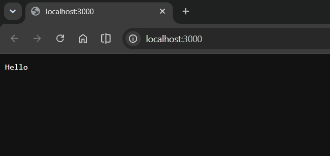
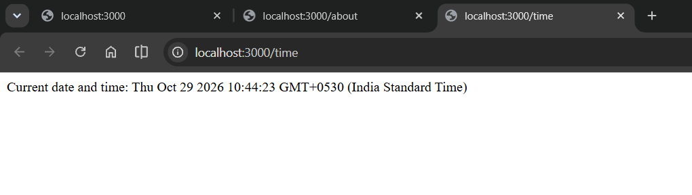
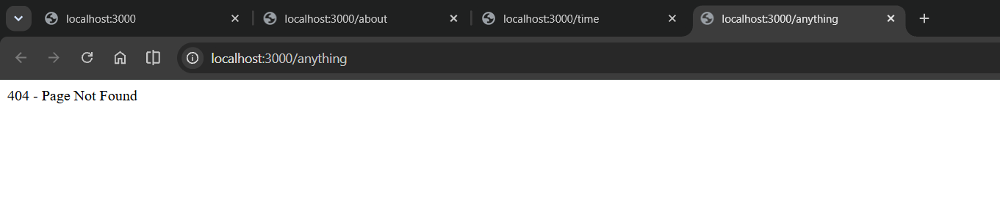

# Lab 1: Node.js and Express Server

**Name:** B. Navadeep &nbsp;|&nbsp; **Registration Number:** 252U1R9017 &nbsp;|&nbsp; **Section:** CSE-GEN-AI 2A 304  
**Course:** Backend Development Fundamentals &nbsp;|&nbsp; **Lab Number:** 01

---

## Live Link

- **Deployment URL:** [https://backend-dev-lab-01.onrender.com/](https://backend-dev-lab-01.onrender.com/)

---

## Objective

To set up a Node.js project, create a basic HTTP server using the built-in `http` module, and build an Express server featuring multiple routes, proper HTTP status codes, and error handling for undefined paths.

---

## Technologies Used

- **Runtime:** Node.js
- **Framework:** Express.js
- **Language:** JavaScript (ES6+)
- **Package Manager:** npm
- **Deployment Platform:** Render
- **Editor:** Visual Studio Code

---

## Project Structure

```text
lab1/
├── screenshots/
│   ├── http-hello.png
│   ├── about.png
│   ├── time.png
│   └── not-found.png
├── .gitignore
├── package.json
├── package-lock.json
├── README.md
├── server-http.js
└── server.js
```

---

## How to Run Locally

### Prerequisites
Make sure **Node.js** (v16+) and **npm** are installed on your system.

### 1. Clone the Repository
```bash
git clone https://github.com/navadeepbasavoju-lgtm/backend_dev_lab_01.git
cd backend_dev_lab_01/lab1
```

### 2. Install Dependencies
```bash
npm install
```

### 3. Run the Express Server (Tasks 4–6)
```bash
npm start
```
*Or directly with Node:*
```bash
node server.js
```
The server will start at `http://localhost:3000`.

### 4. Run the Plain HTTP Server (Built-in `http` module)
```bash
npm run start:http
```
*Or directly with Node:*
```bash
node server-http.js
```
> [!NOTE]
> Stop one server (`Ctrl + C`) before starting the other, as both listen on port 3000 by default.

---

## API Endpoints

| Method | Endpoint | Description | Status Code | Response Format |
| :--- | :--- | :--- | :--- | :--- |
| `GET` | `/` | Returns a welcome message | `200 OK` | Plain text |
| `GET` | `/about` | Returns student information (Name, Reg. No, Section) | `200 OK` | JSON |
| `GET` | `/time` | Returns the current server date and time | `200 OK` | Plain text |
| `GET` | `/anything` | Catch-all route for unhandled or unknown routes | `404 Not Found` | Plain text |

---

## Screenshots

### 1. Plain HTTP Server (`node server-http.js`)
Built-in `http` module server replying with "Hello" on port 3000.



### 2. About Route (`/about`, 200 OK)
Returns student details as a JSON response.


### 3. Time Route (`/time`, 200 OK)
Returns the current date and time using `new Date()`.



### 4. Unknown Route (`/anything`, 404 Not Found)
Handles undefined routes by returning a 404 error message.



---

## HTTP Status Codes Used

- **`200 OK`**: The request was successful and the response body contains the requested data.
- **`404 Not Found`**: The server could not find a route matching the requested path.

---

## package.json Fields Explanation

| Field | Description |
| :--- | :--- |
| `name` | Name of the project / package (`bdf-lab-01`) |
| `version` | Current semantic version of the project (`1.0.0`) |
| `description` | Brief summary of what the project does |
| `main` | Entry point file of the application (`server.js`) |
| `scripts` | CLI shortcuts runnable via `npm run <script>` (e.g., `start`, `start:http`) |
| `keywords` | Array of search terms for package discovery |
| `author` | Creator/maintainer of the project (`B. Navadeep`) |
| `license` | License governing usage rights (`ISC`) |
| `dependencies` | External npm packages required at runtime (`express`) |

---

## Viva Questions & Answers

1. **What is the difference between `package.json` and `node_modules`?**
   - `package.json` contains metadata, configuration, scripts, and lists the dependencies and versions needed by the project.
   - `node_modules` is the actual folder containing all the downloaded code and libraries for those dependencies. It can be re-generated anytime using `npm install` and should not be committed to version control.

2. **What does `app.listen()` do?**
   - It binds and listens for incoming HTTP connections on the specified port and host, putting the Express application into an active state ready to receive requests.

3. **What do `req` (Request) and `res` (Response) represent?**
   - `req` represents the HTTP request object, containing details like HTTP method, URL, headers, query parameters, and body.
   - `res` represents the HTTP response object, used to set the HTTP status code, response headers, and send data (text, HTML, JSON) back to the client.

---

## Notes & Problems Faced

- **Port in use:** If port 3000 is occupied by another process (or when switching between `server-http.js` and `server.js`), stop the active process using `Ctrl + C`.
- **Dynamic Port for Deployment:** Deployed platforms (like Render) assign dynamic ports via `process.env.PORT`. The application falls back gracefully to `3000` locally:
  ```javascript
  const PORT = process.env.PORT || 3000;
  ```

---

## Git & Deployment Notes

- `.gitignore` ignores `node_modules/`, `.env`, and OS-generated files.
- Production hosting deployed on **Render**: [https://backend-dev-lab-01.onrender.com/](https://backend-dev-lab-01.onrender.com/)
